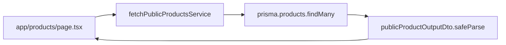
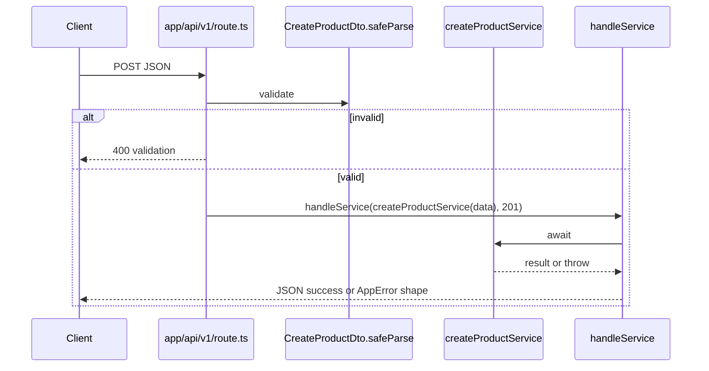
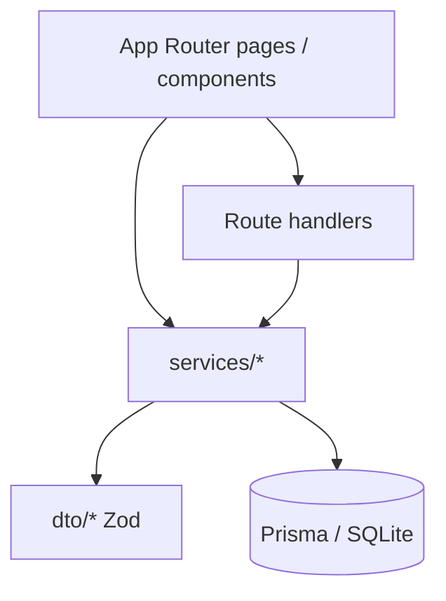
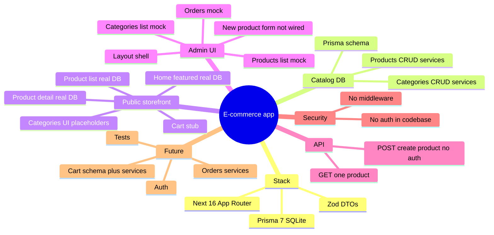

# Data flow, imports, and diagrams

**Last updated:** 2026-04-08

## Typical server component flow (public products)

## API route flow (`app/api/v1/route.ts`)

## Intended layering

**Current caveat:** many UI paths use **`shared/placeholders`** or **inline admin mocks** instead of services.

## Mind map (feature × status)

## Key import directions

- **Pages (RSC)** → `@/services/products/fetch` (and similar) → `@/lib/prisma` (inside services).
- **Services** → `@/dto/*`, `@/errors/*`, `@/dto/select.dto` (`buildSelect`), `@/lib/prisma`.
- **API route** → DTOs, `handleService`, product services.

---

[← Architecture summary](./architecture-summary.md) · [Blockers and risks →](./blockers-gaps-and-risks.md)
